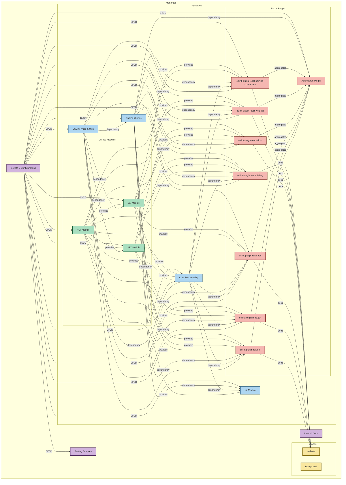

import { InlineTOC } from "fumadocs-ui/components/inline-toc";

<Callout type="warn" title="Under Construction">
  This page is under construction.
</Callout>

Contributions are welcome!

This project does not have contributing guidelines. Explore the [repository](https://github.com/Rel1cx/eslint-react) to learn how to contribute.

<InlineTOC items={toc}>Table of Contents</InlineTOC>

## Monorepo Structure

This section provides a reference to the repository structure and the relationships between different components.

## Packages Summary

This section provides a summary of the packages in the monorepo.

### Local Packages

- [`.pkgs/eff`](https://github.com/Rel1cx/eslint-react/tree/main/.pkgs/eff): JavaScript and TypeScript utilities
- [`.pkgs/configs`](https://github.com/Rel1cx/eslint-react/tree/main/.pkgs/configs): Workspace config bases
- [`.pkgs/samples`](https://github.com/Rel1cx/eslint-react/tree/main/.pkgs/samples): Sample custom rule implementations used by examples and documentation
- [`.pkgs/testkit`](https://github.com/Rel1cx/eslint-react/tree/main/.pkgs/testkit): Shared test construction kit for unit tests and rule tests

### Utility Packages

These packages are published to npm as dependencies of the ESLint plugins, but they are intended as internal building blocks rather than standalone public APIs.

- **Utilities**
  - [`packages/ast`](https://github.com/Rel1cx/eslint-react/tree/main/packages/ast): TSESTree AST utility module for static analysis
  - [`packages/var`](https://github.com/Rel1cx/eslint-react/tree/main/packages/var): TSESTree AST utility module for static analysis of variables
  - [`packages/jsx`](https://github.com/Rel1cx/eslint-react/tree/main/packages/jsx): TSESTree JSX utility module for static analysis of JSX patterns
- **Core & Shared**
  - [`packages/core`](https://github.com/Rel1cx/eslint-react/tree/main/packages/core): Utility module for static analysis of React core APIs and patterns
  - [`packages/eslint`](https://github.com/Rel1cx/eslint-react/tree/main/packages/eslint): ESLint types and utilities
  - [`packages/shared`](https://github.com/Rel1cx/eslint-react/tree/main/packages/shared): Shared constants, types and functions

### Public Packages

- **Utilities**
  - [`packages/kit`](https://github.com/Rel1cx/eslint-react/tree/main/packages/kit): Utility module for building custom React rules with JavaScript functions
- **ESLint Plugins**
  - [`plugins/eslint-plugin-react-x`](https://github.com/Rel1cx/eslint-react/tree/main/plugins/eslint-plugin-react-x): Core React rules
  - [`plugins/eslint-plugin-react-jsx`](https://github.com/Rel1cx/eslint-react/tree/main/plugins/eslint-plugin-react-jsx): React Flavored JSX rules
  - [`plugins/eslint-plugin-react-rsc`](https://github.com/Rel1cx/eslint-react/tree/main/plugins/eslint-plugin-react-rsc): React Server Components rules
  - [`plugins/eslint-plugin-react-dom`](https://github.com/Rel1cx/eslint-react/tree/main/plugins/eslint-plugin-react-dom): React DOM rules
  - [`plugins/eslint-plugin-react-web-api`](https://github.com/Rel1cx/eslint-react/tree/main/plugins/eslint-plugin-react-web-api): Web API interaction rules
  - [`plugins/eslint-plugin-react-naming-convention`](https://github.com/Rel1cx/eslint-react/tree/main/plugins/eslint-plugin-react-naming-convention): Naming convention rules
  - [`plugins/eslint-plugin-react-debug`](https://github.com/Rel1cx/eslint-react/tree/main/plugins/eslint-plugin-react-debug): Debugging rules for inspecting React patterns in code
  - [`plugins/eslint-plugin`](https://github.com/Rel1cx/eslint-react/tree/main/plugins/eslint-plugin) (npm: `@eslint-react/eslint-plugin`): A unified plugin that combines all individual plugins into one

### Examples

- [`examples/next`](https://github.com/Rel1cx/eslint-react/tree/main/examples/next): Next.js example
- [`examples/preact`](https://github.com/Rel1cx/eslint-react/tree/main/examples/preact): Preact example
- [`examples/preact-compat`](https://github.com/Rel1cx/eslint-react/tree/main/examples/preact-compat): Preact compat example
- [`examples/react-dom`](https://github.com/Rel1cx/eslint-react/tree/main/examples/react-dom): React DOM example
- [`examples/react-dom-js`](https://github.com/Rel1cx/eslint-react/tree/main/examples/react-dom-js): React DOM JS example
- [`examples/react-dom-oxlint`](https://github.com/Rel1cx/eslint-react/tree/main/examples/react-dom-oxlint): React DOM with Oxlint example
- [`examples/react-dom-with-custom-rules`](https://github.com/Rel1cx/eslint-react/tree/main/examples/react-dom-with-custom-rules): React DOM with custom rules example
- [`examples/tanstack-redact`](https://github.com/Rel1cx/eslint-react/tree/main/examples/tanstack-redact): TanStack Redact example
- [`examples/tanstack-start`](https://github.com/Rel1cx/eslint-react/tree/main/examples/tanstack-start): TanStack Start example

### Documentation

- [`apps/website`](https://github.com/Rel1cx/eslint-react/tree/main/apps/website): Documentation website
- [`apps/playground`](https://github.com/Rel1cx/eslint-react/tree/main/apps/playground): Interactive playground (placeholder)
